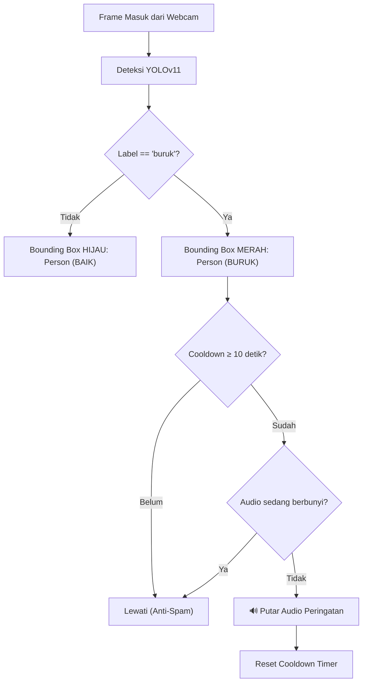

# 🪑 Sitting Posture Tracker — YOLOv11 & Audio Alert

Sistem cerdas pelacakan dan klasifikasi postur duduk (**Baik** dan **Buruk**) secara real-time menggunakan model deep learning **YOLOv11** dengan notifikasi audio otomatis anti-spam.

Dirancang untuk mendeteksi posisi duduk di depan **webcam laptop** maupun kamera ruangan, membantu mencegah kebiasaan postur duduk membungkuk/buruk saat bekerja atau belajar.

---

## 🌟 Fitur Utama

- 🎯 **Deteksi Postur Real-Time**: Klasifikasi otomatis postur duduk menjadi **BAIK** (hijau) atau **BURUK** (merah).
- 💻 **Optimal untuk Webcam Laptop**: Dilatih menggunakan dataset frontal webcam laptop sudut depan dan samping.
- 🔊 **Peringatan Suara Otomatis**: Memutar audio peringatan saat terdeteksi postur buruk.
- ⏱️ **Mekanisme Anti-Spam Cooldown**: Audio dilengkapi timer jeda (default: 10 detik) dan verifikasi status pemutaran agar tidak berisik atau spam.
- 🔄 **Dual Engine Audio**: Mendukung `pygame` dan fallback otomatis ke `Windows Native MCI (ctypes)` tanpa perlu install dependensi tambahan di Windows.

---

## 📁 Struktur Repositori

```
├── sitting_posture_tracker.py        # Script utama deteksi real-time & audio alert
├── train_model.py                    # Script pelatihan model YOLOv11
├── merge_datasets.py                 # Script standarisasi dan penggabungan dataset
├── hey-antek-antek-asing-prabowo.mp3 # File audio peringatan postur buruk
├── best.pt                           # Bobot model YOLOv11 terlatih
├── requirements.txt                  # Daftar dependensi Python
├── SittingPostureTracker.md          # Dokumentasi teknis lengkap
└── README.md                         # Dokumentasi repositori
```

---

## 🚀 Panduan Instalasi & Penggunaan

### 1. Kloning Repositori
```bash
git clone https://github.com/Khazennn234-gif/Sitting-Posture-Tracker.git
cd Sitting-Posture-Tracker
```

### 2. Instalasi Dependensi
```bash
pip install -r requirements.txt
```

### 3. Menjalankan Tracker
Jalankan program utama menggunakan webcam laptop:
```bash
python sitting_posture_tracker.py
```

- Duduk tegak di depan kamera $\rightarrow$ Bounding box **HIJAU** `Person (BAIK)`
- Membungkuk / posisi buruk $\rightarrow$ Bounding box **MERAH** `Person (BURUK)` dan memutar audio peringatan.
- Tekan tombol **`q`** pada jendela video untuk keluar.

---

## 🏋️ Pelatihan Model (Opsional)

Jika ingin melatih ulang model dengan dataset sendiri:

1. Letakkan dataset YOLO Anda pada direktori yang diinginkan.
2. Gunakan `merge_datasets.py` untuk menyelaraskan label:
   ```bash
   python merge_datasets.py
   ```
3. Latih model dengan `train_model.py`:
   ```bash
   python train_model.py
   ```

---

## ⚙️ Logika Kontrol Anti-Spam Audio



---

## 📄 Lisensi
Proyek ini dikembangkan untuk keperluan akademik dan pemantauan ergonomi kerja.
